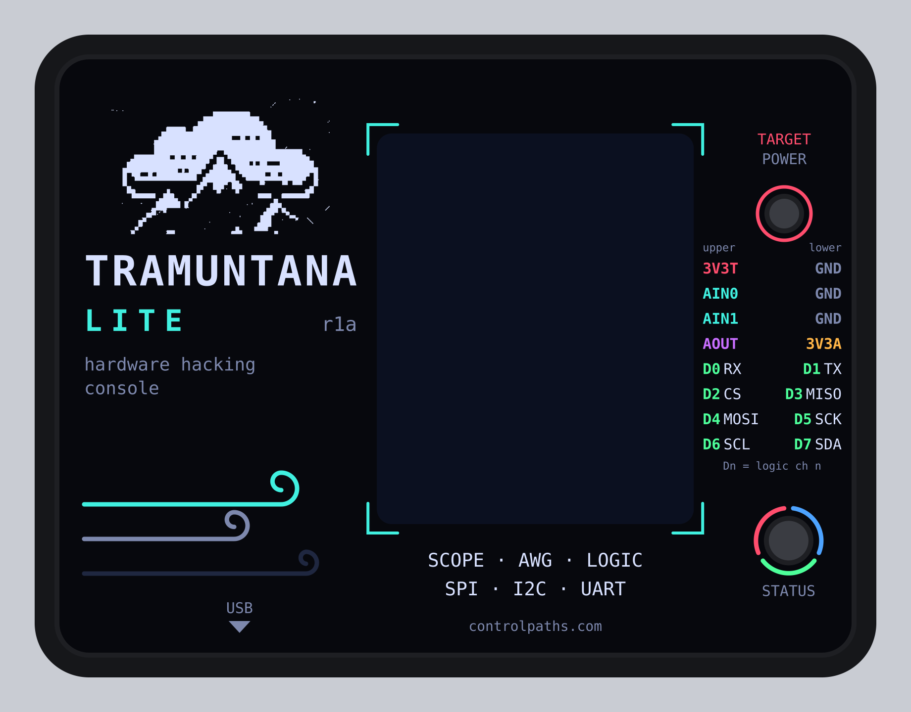

# Tramuntana Lite r1a — caja imprimible

Caja de dos piezas (base y tapa) para imprimir en 3D. Hay dos juegos de
tapas sobre la misma base:

- **Translúcida** (`_lid`, `_lid_nodisplay`): los LEDs se ven a través del
  plástico, así que no llevan agujeros; el display sí tiene ventana.
- **Opaca** (`_lid_opaque`, `_lid_opaque_nodisplay`), para filamento negro:
  cada LED tiene un agujero en el techo y un tubo que baja hasta casi tocarlo,
  para rellenarlo de silicona transparente y que haga de guía de luz (ver
  [Tapa opaca](#tapa-opaca-guías-de-luz)).

| Fichero | Qué es |
|---|---|
| `tramuntana_lite_case_base.step` / `.stl` | base, se imprime tal cual (suelo sobre la cama) |
| `tramuntana_lite_case_lid.step` | tapa, en posición de montaje |
| `tramuntana_lite_case_lid.stl` | tapa ya girada para imprimir (techo sobre la cama) |
| `tramuntana_lite_case_lid_nodisplay.step` / `.stl` | tapa cerrada, sin ventana, para placas sin display (misma base y tornillos; el `.stl` ya girado para imprimir) |
| `tramuntana_lite_case_lid_opaque.step` / `.stl` | tapa para filamento negro, con ventana y guías de luz para los LEDs (`.stl` ya girado para imprimir) |
| `tramuntana_lite_case_lid_opaque_nodisplay.step` / `.stl` | ídem, cerrada, para placas sin display |
| `tramuntana_lite_case_assembly.step` | base + tapa + PCB y componentes, para comprobar el montaje |
| `case.py` | el modelo paramétrico (CadQuery) que genera todo lo anterior |

## Medidas

- Exterior: **85.0 × 65.0 × 15.1 mm**, aristas redondeadas (esquinas r 5.5,
  bordes superior e inferior r 2).
- Paredes de 2 mm, 0.5 mm de holgura alrededor de la PCB (80 × 60 × 1.6):
  hueco de 81 × 61 mm, que cubre la tolerancia del contorno de la PCB
  (±0.2 mm) y los ~0.2 mm por lado que encogen los huecos al imprimir.
- Base: suelo de 2 mm y 3 mm libres bajo la PCB para los pines pasantes;
  sube hasta la cara superior de la PCB (6.6 mm).
- Tapa: 6.5 mm libres sobre la PCB (display de 6 mm + 0.5) y techo de 2 mm.
- Aberturas: micro-USB de la Pico 2 (12 × 8.5 mm, borde inferior) y J1
  (23 × 6.7 mm, borde derecho: header, conectores dupont o el zócalo de un
  addon; baja 1.2 mm por debajo de la cara superior de la PCB, así que
  parte del hueco queda en la base, y se queda 1 mm por debajo del techo).
  Ventana del display 31 × 38.5 mm, de y = 13.5 a 52 mm (se probó
  ensanchada 1 mm por la izquierda y 1 mm más alta, pero se veía el borde
  blanco de la pantalla por la izquierda y por arriba).

## Tapa opaca: guías de luz

| LED | Posición (x, y) | Agujero | Tubo | Hueco sobre el LED |
|---|---|---|---|---|
| D3, RGB 5050 (estado) | 73.6, 11.3 mm | Ø4.0 mm | Ø6.4 mm | 0.5 mm |
| D7, 0603 de `/3V3_TARGET` (salida activa) | 73.2, 44.4 mm | Ø3.0 mm | Ø5.4 mm | 0.5 mm |

Cada tubo cuelga del techo (paredes de 1.2 mm, `PIPE_WALL`) y termina a
0.5 mm (`PIPE_GAP`) sobre su LED: la luz entra por abajo y sale por el
agujero del techo, que atraviesa la tapa entera. Al imprimir la tapa (techo
sobre la cama) los tubos crecen hacia arriba, sin voladizos.

Para rellenarlos: tapa los dos agujeros por fuera con cinta (kapton o de
carrocero, bien pegada), deja la tapa con el interior hacia arriba y llena
cada tubo de silicona transparente desde dentro, hasta enrasar con el borde
del tubo. Al quitar la cinta, la cara exterior queda plana y lisa. Una
silicona que cure en profundidad (de adición / RTV-2, o silicona neutra de
curado lento) va mejor que la acética de cartucho en tubos de 6–7 mm.

Las posiciones salen del `.kicad_pcb`. La altura del 5050 se toma de 1.6 mm;
si el tuyo es más alto, sube `LEDS["led_rgb"]` o `PIPE_GAP`.

## Tornillos

Los cuatro atraviesan la base y los agujeros M3 de la placa y roscan en las
torretas de la tapa (Ø6 mm, agujero de **2.5 mm**, el M3 se hace la rosca
en el plástico). Tornillos **M3 × 10 mm** con cabeza de hasta Ø5.5 × 2 mm;
paso de Ø3.4 mm en la base. Imprime la tapa con 4 perímetros o más para
que las torretas (1.75 mm de pared) no se abran al roscar; la
base lleva un cajeado de Ø6.2 × 2.4 mm para la cabeza (holgado porque los
agujeros impresos salen más pequeños; la cabeza queda 0.4 mm hundida). Con
10 mm rosca 5.8 mm en la torreta y la punta queda a 0.7 mm del fondo; el
máximo es 10.7 mm (uno de 11 mm entraría 0.3 mm en el techo de 2 mm).

La placa queda pinzada entre los soportes de la base y las torretas de la
tapa. Como el cajeado (Ø6.2 × 2.4) es más ancho que el soporte (Ø6) y más
hondo que el suelo (2 mm), cada soporte nace de un pie de Ø8.5 mm que
envuelve el cajeado y se une al suelo, y se estrecha a 45° hasta Ø6 antes
de tocar la PCB. `case.py` avisa si alguna pieza sale en más de un sólido.

## Regenerar o ajustar

```bash
python3 -m venv .venv && .venv/bin/pip install cadquery
.venv/bin/python case.py
```

`case.py` imprime el tamaño, las alturas y una comprobación de
interferencias (PCB, display, Pico 2, USB, J1 y pines contra base y tapa).
Parámetros al principio del fichero:

- `CLEAR` holgura de la PCB, `WALL` / `FLOOR` / `CEIL` espesores.
- `DISPLAY_H` altura del display; `OVER` hueco sobre la PCB.
- `PILOT_D` agujero de las torretas, `SCREW_CLEAR_D`, `HEAD_D`/`HEAD_DEPTH`.
- `LEDS` posición, tamaño, altura y diámetro de agujero de cada LED;
  `PIPE_WALL` / `PIPE_GAP` pared del tubo y hueco sobre el LED (tapas opacas).
- `DISPLAY_WINDOW = False` quita la ventana de la tapa normal (la tapa
  `_nodisplay` se genera siempre cerrada); `WINDOW` y `WINDOW_Y0`
  tamaño y posición de la ventana.

## Pegatina de la tapa



`tramuntana_lite_sticker.svg` es la pegatina para el techo de la tapa, a
escala 1:1 en mm: **80 × 60 mm, r 3** (el contorno de la PCB), que cabe en la
zona plana del techo (81 × 61, r 3.5) con 0.5 mm de margen. Lleva el logo de
la webapp, el pinout de J1 junto a su abertura (cada fila a la altura de su
par de pines) y agujeros para la ventana del display (+0.5 mm por lado) y
los dos LEDs (Ø5 el RGB, Ø4 el de `3V3_TARGET`), así que vale tanto para la
tapa translúcida como para la opaca. Para las tapas `_nodisplay` habría que
quitar el agujero de la ventana.

El SVG tiene dos capas: `Artwork`, con 1.5 mm de sangrado, y `CutContour`,
las líneas de corte (contorno y agujeros, trazo magenta de 0.1 mm), que es lo
que esperan las imprentas de pegatinas troqueladas y los plotters de corte.
El texto va convertido a curvas, no hacen falta las fuentes. Los colores son
la paleta de la webapp (`host/webapp/style.css`).

Se genera con `sticker.py`, que toma las posiciones de `case.py`:

```bash
.venv/bin/pip install fonttools pillow cairosvg
.venv/bin/python sticker.py
```

Se supone que los pines impares de J1 (los de la fila más alejada del borde)
son la fila de **arriba** del conector acodado; si no, intercambia
`upper`/`lower` en `sticker.py`.

## Suposiciones

- La posición del display sale del contorno serigrafiado del PCB (34 × 56
  mm); la del cristal dentro del módulo no está medida. La ventana empezó
  generosa (31 × 43.5 mm) y se ha recortado 4 mm por abajo (el lado del
  flex) y 1 mm por arriba: 31 × 38.5 mm. Si queda desplazada, ajusta
  `WINDOW_Y0`, la altura en `WINDOW` y `WINDOW_EXTRA_LEFT`.
- La Pico 2 se modela con 4.5 mm de alto y su micro-USB centrado en su
  borde corto, a x = 18.2 mm del borde izquierdo de la placa.
- El botón BOOTSEL de la Pico queda dentro: para reflashear sin abrir la
  caja, `tramuntana bootloader`.
